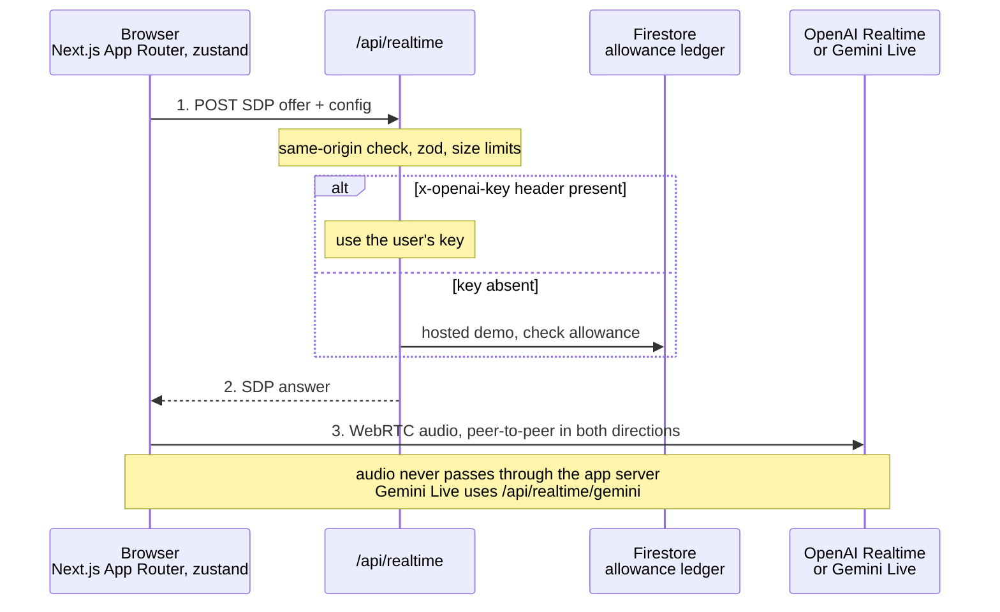
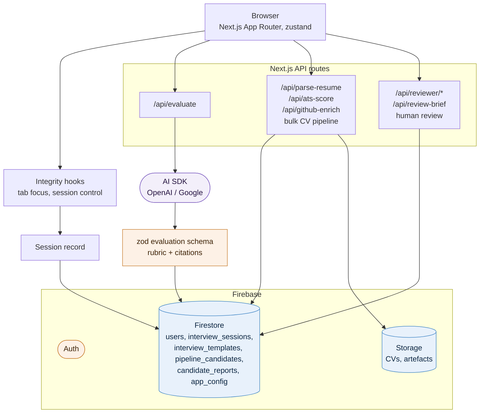

# InterviewMate

An English-first recruiting prototype that conducts structured or adaptive voice interviews, helps a human reviewer inspect competency evidence, and gives recruiters a bulk CV-to-interview pipeline. Bahasa Indonesia is a separate multilingual test.

The inherited Next.js application is the baseline. This revision replaces unexplained interview percentages with a cited 0–4 evidence rubric, explicit missing-evidence states and contextual human review. The prototype release is live at [interviewmate-ai.shiverion.com](https://interviewmate-ai.shiverion.com/); the latest evidence is the [production release record](docs/hr-product-sprint/evaluation/results/2026-09-11-production-release.md).

- [Product_Sprint.md](Product_Sprint.md): authoritative challenge, accepted requirements and decisions.
- [Five-phase progress](docs/README.md): current work, release checks and the remaining video artifact.
- [Case study, PRD and engineering handoff](deliverables/case-study-and-prd.md): editable source with UX/AI diagrams; use the [PDF submission package](deliverables/InterviewMate-Submission-Package.pdf) for a polished reviewer attachment.
- [MVP expected-output audit](deliverables/mvp-readiness-audit.md): D1–D5 evidence, prototype format and remaining baseline/video work.
- [Submission package](deliverables/README.md): current artifacts and superseded exports.
- [Setup and validation](docs/hr-product-sprint/implementation/current-runbook.md).
- [Bulk CV pipeline and candidate dashboard](docs/hr-product-sprint/implementation/2026-09-11-bulk-pipeline.md).
- [CV pipeline validation checklist](docs/hr-product-sprint/evaluation/cv-pipeline-validation.md).
- [Five-minute demo script](deliverables/demo-script.md).

## System Design

### Requirements

**Functional**
- Conduct structured or adaptive **real-time voice interviews** from a role description, CV, and projects.
- Score answers on a **cited 0–4 evidence rubric**, with explicit missing-evidence states and human review.
- A recruiter pipeline: bulk CV parsing, ATS scoring, GitHub enrichment, candidate dashboard, scheduled interviews.
- Reviewer access by private invitation; a rate-limited hosted demo for signed-in visitors.

**Non-functional**
- **Low conversational latency**: audio streams peer-to-peer to the model, not through the app server.
- **Accountability**: every score links to transcript evidence; no unexplained percentages.
- **Cost control**: bring-your-own-key by default; host-paid demo usage is metered in a Firestore ledger.
- **Serverless**: Vercel with no writable filesystem; secrets are server-side only.

### High-Level Architecture

Access to every collection is governed by the Firestore rules in the next table; anything not listed is denied by default.

### Data Model and Access

| Collection | Contents | Access (Firestore rules) |
| --- | --- | --- |
| `users/{uid}` | Profile, role | Owner |
| `interview_sessions/{id}` | Transcript, integrity events, evaluation | Owner, admin, invited reviewer within the review window |
| `interview_templates/{id}` | Question banks and competencies | Owner |
| `pipeline_candidates/{id}`, `candidate_reports/{id}` | Bulk CV pipeline outputs | Recruiter owner |
| `app_config/{id}` | Admin pointer, demo settings | Admin only |
| everything else | n/a | Denied by default |

Rules are tested with `@firebase/rules-unit-testing` (`scripts/test-access-rules.mjs`). Reviewer access expires at a fixed cutoff enforced in both the app and the rules.

### Evaluation Design

- Structured output validated by a zod schema: per-competency 0–4 scores, cited transcript excerpts, and an explicit "insufficient evidence" state.
- A weighted overall score (communication 15%, reasoning 20%, relevance 15%, technical depth 20%, production experience 15%, skill match 10%, confidence 5%) is computed in code from the rubric, not by the model.
- A human reviewer confirms or overrides each competency before a report is final.

### Trade-offs

| Decision | Benefit | Cost |
| --- | --- | --- |
| WebRTC direct to the model provider | Lowest latency; no audio through Vercel | Transcript capture depends on client events |
| BYOK with a metered hosted fallback | Near-zero host cost | Keys stored client-side (base64 obfuscation only, demo-grade) |
| Two realtime providers | Provider choice and failover | Two session adapters to maintain |
| Firestore and Storage with rules | No custom backend for data access | Complex rules; must be tested on every change |

### What to Revisit as It Grows

- Replace client-stored keys with server-side encrypted key storage (KMS) per workspace.
- Move bulk CV processing to a queue (Cloud Tasks or Pub/Sub) with retries instead of request-bound routes.
- Add calibration studies (inter-rater agreement between rubric and human reviewers) before any hiring-validity claim.
- Add per-tenant data isolation and retention policies before multi-company use.

## Run locally

Use Node 24 (Node 20.9 or newer also works locally). Run `npm install`, then `npm run dev`; open http://localhost:3000. Add personal provider keys in Settings, or configure host credentials for Demo/Reviewer Mode as described in the runbook. Signing in does not force API-key setup.

Reviewers enter a private invitation at `/reviewer`. Signed-in visitors use `/demo` for the hosted voice demo; the demo allowance is backed by the Firestore ledger and tied to the authenticated browser session. Production runs on Vercel with encrypted server-side credentials and no writable deployment filesystem.

### Reviewer admin login

The owner creates a separate seven-day email/password account for portfolio reviewers in Firebase Console: `reviewer@interviewmate.demo`. Keep account creation private, then share its password privately with reviewers. This demo account expires on 18 September 2026 at 00:00 UTC; update the cutoff in `src/lib/firebase/access.ts`, `firestore.rules` and `storage.rules` before issuing a new review window. It opens the full workspace without using the owner's Google account. The owner's UID pointer in `app_config/admin` remains controlled by the primary administrator.

Prototype status: the recorded release passed **191 tests across 25 suites**, TypeScript, production build and Node 24 CI. Production smoke and owner acceptance are documented. The MVP is demonstrable; the [submission audit](deliverables/mvp-readiness-audit.md) retains unmeasured baseline timing, the missing five-minute video and final access/portal checks. No hiring-validity, recruiter time-saving or independent model-quality claim is established.
